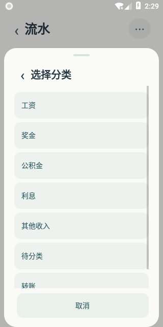
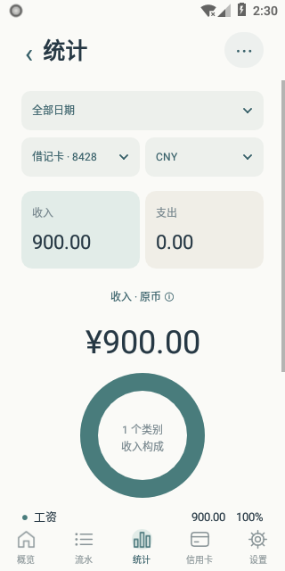
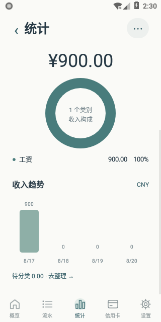

# BOC SMS Ledger · 中行短信账本

把中国银行短信变成手机里的收支账本。自动读取借记卡与信用卡交易，按账户整理流水、标记分类，并查看收入、支出和信用卡账期统计。

**当前版本：0.1.11 · Android 8.0+ · Kotlin / 原生 Android / SQLite**

[版本发布](https://github.com/chinatsu-yan/boc-sms-ledger/releases/tag/v0.1.11) · [下载安装包](https://github.com/chinatsu-yan/boc-sms-ledger/blob/v0.1.11/downloads/boc-sms-ledger-0.1.11-debug.apk) · [更新记录](docs/update-0.1.11.md)

## 功能

| 模块 | 功能 |
| --- | --- |
| 首页 | 借记卡收入、支出及短信余额快照，借记卡与信用卡独立展示 |
| 自动记账 | 首次授权导入历史短信，收到新短信与回到 App 时自动补扫 |
| 流水 | 按日期、账户、币种、分类筛选，搜索原文、商户与金额 |
| 分类 | 点选分类直接保存、批量分类、自定义收入与支出类别、商户别名与默认分类规则 |
| 统计 | 收入/支出切换、分类环图、类别排行、时间趋势；按账户与原币查看 |
| 信用卡 | 可配置账单日和还款日，默认展示最近还款日对应账期 |
| 外币 | 每笔显示原币与交易日美元参考额；外币合计另折人民币参考额，人民币消费单列 |
| 撤销与退货 | 同卡、同币种、同商户、同金额匹配最早可冲销消费；支持双侧原文核对、手动关联及解除 |
| 本地账本 | 保存原始短信、人工修正及关联记录；重解析保留人工处理结果 |

收入分类包含工资、奖金、公积金、利息和其他收入，也可以自行添加。未分类收入在统计中显示为“待分类”；标为转账的记录从收入分类统计中排除。首页展示的是借记卡资金流入/流出，信用卡消费独立统计。

## 界面预览

以下为 App 实际运行截图，使用合成演示数据。

| 收入分类 | 收入统计 | 收入趋势 |
| :---: | :---: | :---: |
|  |  |  |

## 安装与使用条件

- **设备**：Android 8.0 及以上。
- **短信来源**：中国银行借记卡及中国银行 Visa 信用卡交易短信，保存在手机系统短信收件箱中。
- **权限**：授予短信读取与接收权限以启用自动记账；后台接收需允许 App 按手机系统设置运行。
- **网络**：外币参考汇率查询需要联网，已有报价可使用本地缓存。查询参数只有币种和日期，短信、账户、商户与金额留在本机。
- **安装包**：下载 `boc-sms-ledger-0.1.11-debug.apk` 后安装。此包沿用此前版本签名，直接覆盖安装即可保留账本。

### 开始使用

1. 打开 App，点击“授权自动扫描”，允许读取短信，现有中行短信会自动导入。
2. 在“流水”选择账户，点击交易旁的分类标签；多笔交易可用“批量分类”。
3. 在“统计”选择日期、账户和币种，点击“收入”或“支出”查看分类与趋势。
4. 使用信用卡时，在日期设置中配置账单日、还款日及“出账当月/次月”，再查看账期和本期流水。
5. 想先体验界面，可打开“更多 → 打开合成演示”。演示与个人账本分开保存。

## 记账示例

### 借记卡收入

下面是一条合成短信：

```text
您的借记卡账户8246，于08月17日收入(公积金)(提取托付)人民币720.00元，交易后余额3150.20【中国银行】
```

识别结果：借记卡转入 **CNY 720.00**，渠道为“公积金 / 提取托付”，余额快照为 **CNY 3,150.20**。点分类标签选择“公积金”后，该笔进入收入分类统计。正文缺失的年份依据这条短信的接收时间推断。

### 信用卡外币

用合成金额与汇率举例：JPY 10,000 × 历史 JPY/USD 0.00625 = **USD 62.50**；再加 USD 20，外币合计 **USD 82.50**。以最新 USD/CNY 7.20 折算，人民币参考额为 **594.00**。另有 CNY 300 消费时单列为人民币部分。

汇率来自 Frankfurter 公共参考数据，页面可查看来源和有效日期；节假日显示采用的实际报价日。账期按短信交易日期计算，换算金额用于日常估算。

### 撤销与退货

一笔 USD 20 消费与其全额撤销关联后，保留两条原始流水，消费净额为 USD 0。需要人工核对时，在关联页面查看退款和原消费的两侧原文后选择；部分退款可通过“其他金额”入口关联。

## 本地构建

使用 JDK 21、Android SDK Platform 35 和 Build Tools 35.0.0。

```bash
git clone https://github.com/chinatsu-yan/boc-sms-ledger.git
cd boc-sms-ledger
./gradlew :core:test :app:assembleDebug :app:lintDebug
```

APK 输出：`app/build/outputs/apk/debug/app-debug.apk`。

工程使用 Kotlin 2.1.20、Android Gradle Plugin 8.9.2、Gradle 8.11.1。`core` 包含解析、金额、账期和统计逻辑；`app` 包含短信接入、本地存储和原生界面。首次构建会在本机生成 debug 签名；已有安装的覆盖升级需要使用相同签名。

## 项目资料

- [最新更新说明](docs/update-0.1.11.md)
- [短信模板与记账口径](docs/sms-templates.md)
- [合成短信样例](fixtures/synthetic/boc-sms.json)
- [构建与开发记录](docs/development.md)
- [安装包校验值](downloads/SHA256SUMS)
